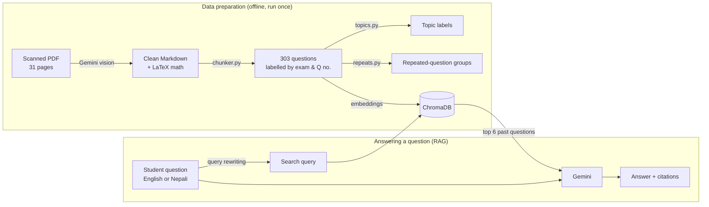

# 📚 IOE Saathi: AI Exam-Prep Assistant for IOE Students

**🔗 Live demo: [ioe-saathi.streamlit.app](https://ioe-saathi.streamlit.app)**

IOE Saathi is an AI study assistant for students of the **Institute of Engineering (IOE), Tribhuvan University, Nepal**. It answers questions about *Digital Signal Analysis and Processing (DSP)* using **18 years of real past exam papers (2066–2083 BS)**, cites the exact exam and question number behind every answer, finds the questions IOE repeats most, generates realistic mock exams, and solves numerical problems step by step with the math checked in Python.

It works in **English and Nepali** (Devanagari and Romanized).


---

## ✨ Features

| Feature | What it does |
|---|---|
| 💬 **Ask Saathi** | Ask about any DSP topic. Answers are grounded in real past questions and cite them, e.g. *(2082 Baishakh, Q3)*. |
| 🇳🇵 **Nepali + English** | Ask *"Z-transform ko ROC ke ho?"* and get an answer in Romanized Nepali. Technical terms stay in English. |
| 🧮 **Solve mode** | Step-by-step solutions to numericals. The model runs Python (NumPy/SciPy) to check every calculation, and the code is shown to the student. Try *"Solve 2083 Bhadra Q8"*. |
| 📊 **Exam Patterns** | Questions per topic, average marks per paper, which question number a topic usually appears as, and when it was last asked. |
| 🔥 **Repeated questions** | 40 questions came in more than one exam, covering **56% of all past questions**. The convolution question has appeared **15 times**, almost always as Q2. |
| 📝 **Smart Mock Test** | One click generates a full 80-mark, 10-question paper in real IOE structure, built from real questions and weighted towards frequently repeated ones. |

---

## ⚙️ How it works



1. **Data cleaning.** The source PDF is a scan whose built-in OCR text was unusable (e.g. `LTNIVERSITY`, garbled formulas). Each page is sent to a Gemini vision model, which transcribes it into Markdown with LaTeX math.
2. **Chunking.** Each paper is split into one chunk per question, labelled with subject, exam session and question number.
3. **Embedding and storage.** Questions are embedded with `all-MiniLM-L6-v2` and stored in ChromaDB.
4. **Retrieval.** A small, fast model first rewrites the student's question into standard DSP terms in English (this also translates Nepali). The database is searched with both the rewritten and the original question.
5. **Generation.** Gemini answers using only the retrieved questions as context and cites their labels. Off-topic questions are refused.

---

## 📏 Evaluation

`evaluate.py` measures the system automatically:

| Test | Result | How it is measured |
|---|---|---|
| **Retrieval accuracy** | **18/18 (100%)** | 15 English questions (many deliberately worded differently from the papers) + 3 Nepali questions. Passes if a relevant past question is retrieved. |
| **Refusal accuracy** | **4/4 (100%)** | Off-topic questions, including a tricky one from another engineering subject (DBMS). |
| **Citation honesty** | **37/37 (100%)** | Every exam citation in 8 answers is checked against the questions actually retrieved. None were invented. |

Solve mode was also checked by hand: a 15-mark Butterworth/bilinear-transform design question was re-derived independently with SciPy, and the filter coefficients matched to 4 decimal places.

---

## 🛠️ Problems I solved along the way

- **Unusable OCR → vision model.** The PDF's text layer was garbage and 4 pages had no text at all. Re-transcribing page images with a vision model produced clean questions with correct LaTeX.
- **Over-refusal.** The first prompt refused *"What is the significance of the Z-transform?"* because no past question asked exactly that. I added retrieval logging to see what was found, then rewrote the rules to separate *off-topic* from *on-topic but not asked word-for-word*.
- **Paraphrased questions (93% → 100% retrieval).** *"Why do ripples appear when we truncate the impulse response?"* didn't find **Gibbs phenomenon**, because students describe concepts without naming them. Adding LLM query rewriting fixed it, and also enabled Nepali questions.
- **Unreliable arithmetic → tool use.** LLMs make small calculation slips on DSP numericals, so Solve mode gives the model a code-execution tool and shows the Python it ran.
- **Repeated-question threshold tuning.** Similarity was computed on question text with exam labels and numbers removed. At a threshold of 0.85, the groups lined up with IOE's paper structure (e.g. inverse Z-transform almost always Q3), even though question numbers were never used in the comparison.
- **The "88 marks" mock test.** Mixing questions from different years broke the 80-mark total. The cause was twofold: IOE's paper format changed over the years (9 to 13 questions), and the data had two errors that only showed up when I checked marks totals per paper: one paper scanned twice, and a continuation page where the AI had invented an exam header. Fixing the data and copying the format of recent papers made every mock test exactly 80 marks.
- **Resilience.** Free-tier models are often busy (503) or rate-limited (429), so every AI call has a timeout, limited retries and automatic fallback to another model.

---

## 🧰 Tech stack

Python · Google Gemini API (Flash models, vision, code execution, structured JSON output) · ChromaDB · all-MiniLM-L6-v2 embeddings · Streamlit · pandas · Altair · PyMuPDF · deployed on Streamlit Community Cloud

---

## 📁 Project structure

```
├── app.py              # Streamlit web app (chat, Exam Patterns, Mock Test)
├── rag.py              # RAG pipeline: query rewriting, retrieval, generation, Solve mode
├── patterns.py         # Exam pattern analysis + repeated questions page
├── mocktest.py         # Smart Mock Test generator
├── transcribe_pdf.py   # Scanned PDF pages -> clean Markdown (Gemini vision)
├── chunker.py          # Markdown pages -> one chunk per question (+ data-quality fixes)
├── embed.py            # Builds the ChromaDB database
├── topics.py           # Tags each question with a syllabus topic (structured output)
├── repeats.py          # Finds repeated questions with embedding similarity
├── evaluate.py         # Automatic evaluation suite
├── chunks.json         # The 303 cleaned, labelled questions
└── practice/           # Early learning scripts
```

---

## ▶️ Run it locally

```bash
git clone https://github.com/shreetikasingh/ioe-saathi.git
cd ioe-saathi
python -m venv venv
source venv/bin/activate        # Windows (Git Bash): source venv/Scripts/activate
pip install -r requirements.txt
echo "GEMINI_API_KEY=your-key" > .env
streamlit run app.py
```

The database is built automatically from `chunks.json` on first start.

---

## ⚠️ Known limitations

- Covers one subject (DSP, old IOE course) for now. The pipeline is subject-agnostic: adding a subject means adding its PDFs and re-running the data scripts.
- Topic labels are assigned by an AI model, so the pattern analysis is a study guide, not an official weighting.
- One paper (2071 Chaitra) has no marks in its scan, so it is skipped by the mock test generator.
- AI-generated solutions can still contain mistakes, so the app labels them and asks students to double-check.
- Runs on Gemini's free tier, so it can be slow or temporarily unavailable under heavy use.

## 🔭 Future work

- More subjects and the new IOE curriculum
- Photo → Solve: snap a question and get a verified solution
- An answer checker that grades a photo of a handwritten answer

---

Made by **Shreetika Singh** · Computer Engineering, IOE